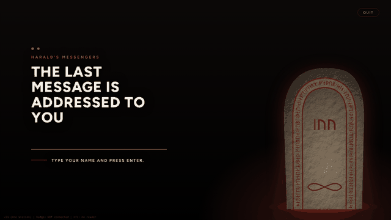
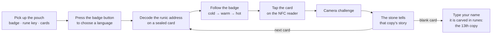
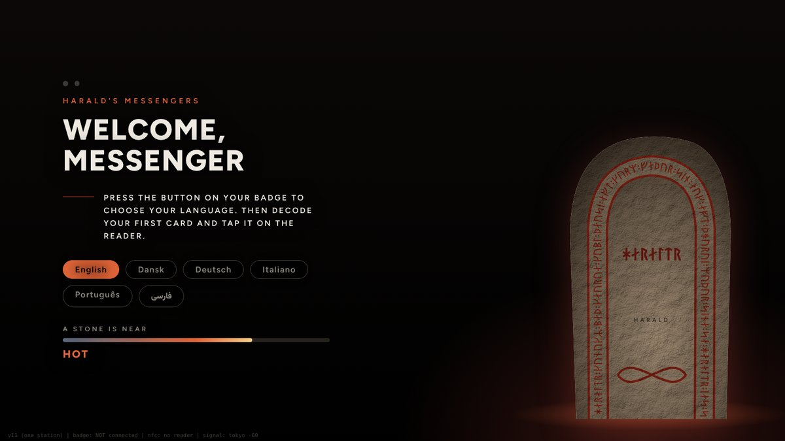
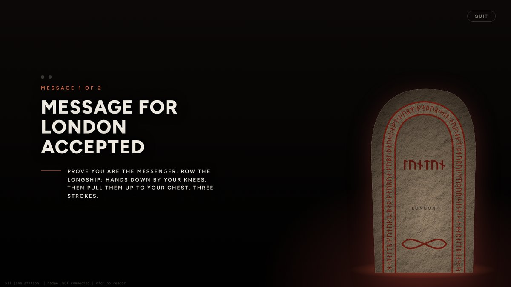
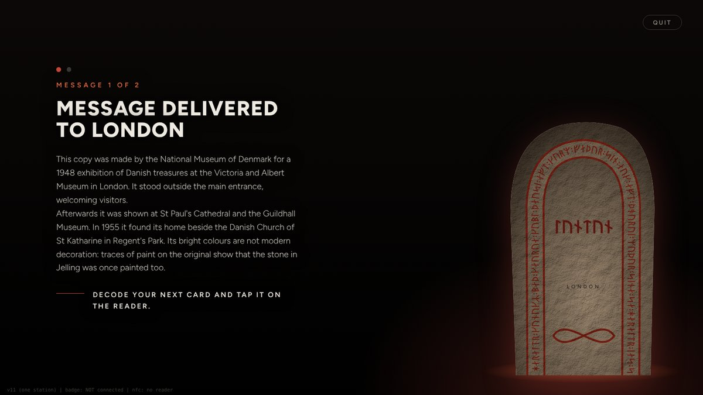
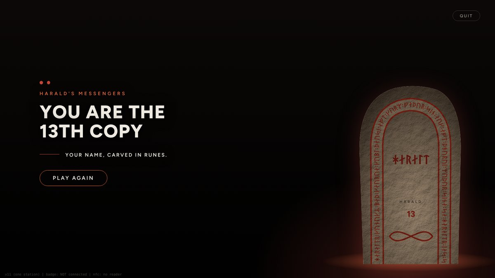
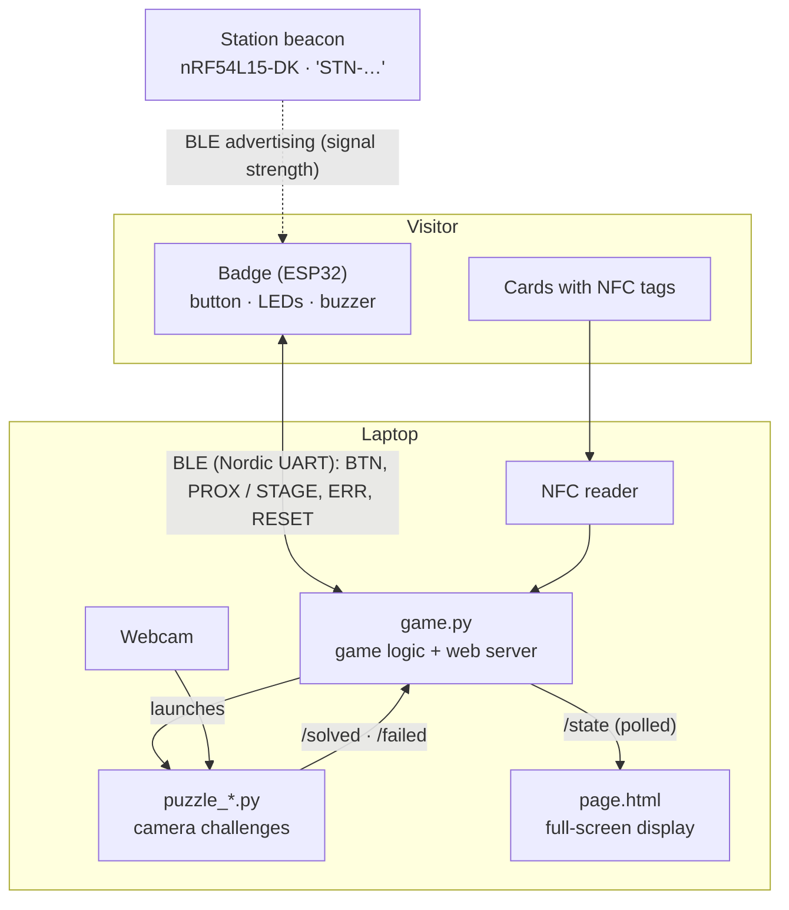

<div align="center">

# ᚼᛅᚱᛅᛚᛏᚱ · Harald's Messengers

**Harald Bluetooth's messages, delivered over Bluetooth.**

An interactive museum experience about the Great Jelling Stone and its copies around the world,
built in one weekend at the **Techathon 2026** at Kongernes Jelling (13–15 November 2026)
by team **Vejolent**.




</div>

---

## The idea

Around 965, King Harald Bluetooth raised the Great Jelling Stone, often called *Denmark's birth certificate*. Since 1889,
at least twelve copies of it have been made and sent around the world: to Paris, Rouen, Utrecht,
London, Yorba Linda, Tokyo, and several places in Denmark. One of them, made for San Francisco in 1915, has been lost.

The museum's challenge was: *how can visitors experience all these copies in one foyer, and could Bluetooth be part of it?*

Our answer: **the visitor becomes one of Harald's messengers.** They get a pouch with a Bluetooth badge,
a rune key and sealed cards addressed in runes. Each card is a message to one of the copies.
They decode the address, follow their badge to the station, prove they are the messenger,
and the stone tells them that copy's story in their own language. The last card is blank:
it carries the visitor's own name, carved in runes, as **the 13th copy**.

## How a visit works



| Step | What happens | Tech |
|---|---|---|
| Choose a language | Each press of the badge button cycles English, Dansk, Deutsch, Italiano, Português, فارسی | ESP32 button → BLE → game |
| Find the station | The badge measures the signal of the station beacon; the screen shows a hot/cold meter and the badge LED blinks faster | nRF54L15 beacon, BLE RSSI |
| Deliver the message | The visitor taps the card on the reader | NFC (PC/SC) |
| Prove you are the messenger | A gesture that comes from that copy's story (see below) | OpenCV + MediaPipe |
| The stone speaks | The copy's story, a photo of it today, and the badge lights up and beeps | Browser screen + BLE |
| The 13th copy | The visitor's name is chiselled into the stone, rune by rune | Younger Futhark transliteration |

### The challenges

| Copy | Challenge | Why |
|---|---|---|
| **Tokyo** | *Become the picture*: spread your arms like the figure on the stone and hold still for 3 seconds | The Tokyo copy only reproduced the **picture** sides in detail; the inscription side is only roughly shaped |
| **London** | *Row the longship*: three strokes with an invisible oar | The London copy crossed the sea for a 1948 exhibition |
| Other copies | No challenge, straight to the story | Paris, Rouen, Utrecht, Yorba Linda, Varde, Hvidovre, Viborg |
| **San Francisco** | *The message never arrives*: the stone on screen fades away | It is the only copy that is truly lost |

## Screenshots

| Start screen with the hot/cold meter | Camera challenge |
|---|---|
|  |  |
| **A copy's story** | **The 13th copy** |
|  |  |

## Architecture



- **`game.py`** is the brain: a small `aiohttp` server holding the game state, talking to the badge over BLE (`bleak`), reading NFC tags (`pyscard`) and launching the camera puzzles.
- **`page.html`** is the screen: plain HTML/CSS/JS, an SVG runestone with Harald's real inscription around the edge, and the carving animation.
- **The badge** is an ESP32 that acts as a BLE peripheral (Nordic UART Service) towards the laptop, and at the same time scans for station beacons and reports their signal strength.
- **The beacon** is an nRF54L15-DK running a tiny Zephyr app that advertises its name, e.g. `STN-TOKYO`.

Every part is optional: without a badge, NFC reader or camera, the game still runs on keyboard shortcuts, which makes it easy to demo and develop.

## Repository layout

```
.
├── game.py                      # game logic, web server, BLE + NFC
├── page.html                    # the full-screen display (edit and reload, no restart needed)
├── stories.json                 # the story of every copy, in 6 languages
├── badge_bridge.py              # laptop side of the BLE link (also a small CLI tester)
├── puzzle_become_picture.py     # Tokyo challenge (MediaPipe Pose)
├── puzzle_row_longship.py       # London challenge (MediaPipe Pose)
├── puzzle_silent_oath.py        # earlier Tokyo challenge (hand signs), not used anymore
├── puzzle_shield_wall.py        # earlier London challenge, not used anymore
├── images/                      # photos and artwork shown in the game (not in the repo, see images/README.md)
├── arduino/
│   ├── badge_ble_v2/            # badge firmware (ESP32)
│   ├── badge_ble_oled/          # same, with an optional SSD1306 OLED distance bar
│   └── station_beacon/          # beacon firmware for a spare ESP32
└── nordic/
    └── station_beacon_nrf54/    # beacon firmware for the nRF54L15-DK (Zephyr / nRF Connect SDK)
```

## Hardware

| Part | Used for |
|---|---|
| ESP32 dev board (ESP-WROOM-32) | The visitor's badge |
| 3 LEDs + 220 Ω resistors, passive buzzer module, push button module | Badge feedback and language button |
| Nordic nRF54L15-DK | Station beacon (any BLE device advertising `STN-…` works, even a phone) |
| USB NFC reader (PC/SC, e.g. ACR122U) + NFC tags | The sealed cards |
| Laptop with a webcam | Game, screen and camera challenges |

### Badge wiring

| Part | ESP32 pin |
|---|---|
| LED 1 (first message) | GPIO 25 → 220 Ω → LED → GND |
| LED 2 (second message) | GPIO 26 → 220 Ω → LED → GND |
| LED 3 (finished / error) | GPIO 27 → 220 Ω → LED → GND |
| Buzzer module `S` / `−` | GPIO 32 / GND |
| Button module `S` / `−` | GPIO 33 / GND (the on-board IO0 button works too) |
| *Optional* OLED (SSD1306, I²C) | SDA → GPIO 21, SCL → GPIO 22, VCC → 3V3, GND → GND |

## Getting started

Tested on Linux (Arch). The game itself is plain Python and should run anywhere; BLE and NFC depend on your OS.

### 1. The game

```bash
python -m venv venv
source venv/bin/activate          # fish: source venv/bin/activate.fish
pip install -r requirements.txt

# camera models for the challenges (from Google's MediaPipe model storage)
curl -LO https://storage.googleapis.com/mediapipe-models/pose_landmarker/pose_landmarker_lite/float16/latest/pose_landmarker_lite.task
# only needed for the old hand-sign puzzle:
curl -LO https://storage.googleapis.com/mediapipe-models/gesture_recognizer/gesture_recognizer/float16/latest/gesture_recognizer.task

CAMERA=0 python game.py           # use CAMERA=1, 2 … if the wrong webcam opens
```

Open <http://localhost:8000> and press **F11** for full screen.

For NFC, install `pcsclite` and `ccid` (and `swig` for building `pyscard`), and start `pcscd`.

### 2. The badge

1. Arduino IDE 2, board package **esp32 by Espressif**, board **ESP32 Dev Module**.
2. Open `arduino/badge_ble_v2/badge_ble_v2.ino` and upload.
3. The badge advertises as `MSG-01`; LED 1 blinks until the game connects.

> **Linux:** if the upload says *Permission denied*, add yourself to the serial group (`uucp` on Arch, `dialout` on Debian/Ubuntu) or run `sudo chmod 666 /dev/ttyUSB0`. Use a **data** USB cable, not a charge-only one.

### 3. The station beacon (nRF54L15-DK)

1. Install VS Code with the **nRF Connect for VS Code** extension pack, plus an nRF Connect SDK (v2.8 or newer) and toolchain.
2. Install **SEGGER J-Link** (on Arch: `jlink-software-and-documentation` from the AUR) and Nordic's udev rules (`nrf-udev`).
3. Open `nordic/station_beacon_nrf54` as an application, add a build configuration for **`nrf54l15dk/nrf54l15/cpuapp`** (not `/ns`), build and flash.
4. LED3 blinks when the beacon is running. BUTTON 0 / BUTTON 1 switch it between `STN-TOKYO` and `STN-LONDON`.

No Nordic board? Flash `arduino/station_beacon` onto a spare ESP32, or advertise a device name like `STN-TOKYO` from the *nRF Connect for Mobile* app.

## Keyboard shortcuts

Press these in the browser window. They let you demo the whole game without any hardware.

| Key | Action |
|---|---|
| `T` `L` `P` `O` `U` `Y` `V` `H` `I` `X` | Tap the card for Tokyo, London, Paris, Rouen, Utrecht, Yorba Linda, Varde, Hvidovre, Viborg, San Francisco |
| `B` | Tap the blank card |
| `S` / `F` | Challenge solved / failed |
| `K` | Next language |
| `1` `2` `3` `4` / `0` | Fake beacon signal: cold … at the station / no beacon |
| `R` | Reset for the next visitor |

When an unknown NFC tag is tapped, the status line asks you to press a city key (or `B`); the tag is then remembered in `cards.json`.

## Configuration

At the top of `game.py`:

| Setting | Default | Meaning |
|---|---|---|
| `MESSAGES_PER_RUN` | `2` | Sealed cards per visitor before the blank card |
| `ONE_STATION` | `True` | One beacon counts as "the station" for every card. Set to `False` to use one beacon per city (`STN-TOKYO`, `STN-LONDON`, …) |
| `PROX_COLD` / `PROX_HOT` | `-85` / `-50` | Signal strength (RSSI) for an empty and a full meter. Read your own values from the status line and adjust |
| `PUZZLES` | Tokyo, London | Which camera challenge each city launches |
| `AUTO_LAUNCH` | `True` | Start the camera challenge automatically when a card is tapped |

The badge has matching `RSSI_FAR` / `RSSI_NEAR` values in its firmware.

## What we learned / next steps

- **Signal strength is jumpy.** It is good for *cold → warm → here*, not for metres. Beacons should be at least 3–4 m apart.
- **A screen on the badge.** We tried a 16×2 character LCD for the distance bar, but it could not get enough contrast from the ESP32's 5 V pin. The next version uses a small OLED (`arduino/badge_ble_oled`).
- **More challenges.** Each copy has a story that could become a gesture: crouch to "plant" the Tokyo stone among flowers, or hold the plastic copy down in the wind.
- **The 13th copy, for real.** A 3D-printed mini runestone with the visitor's name to take home, and a wall where every visitor's stone appears.

## Sources and credits

- The case and material were provided by **Kongernes Jelling / the National Museum of Denmark** for the Techathon.
- The copy stories are our own summaries of *"Runesten i verden"* and of background notes from the Danish Church in London and the Danish Lutheran Church in Yorba Linda.
- Harald's inscription on the screen is the text of the Great Jelling Stone (DR 42), written in Younger Futhark.
- The photos of the copies and the Viking illustration used during the demo belong to their owners and are **not** included in this repository.

Made with ᛒ (and a lot of jumper wires) by team **Vejolent**.

## License

The code is released under the [Apache License 2.0](LICENSE).
